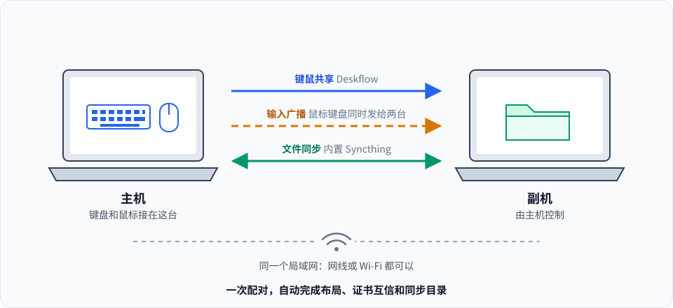

# Deskflow 双机套件

一套键盘鼠标控制两台电脑，鼠标键盘动作可以同时发给两台，两台之间还自动同步一个文件夹。
两台电脑上各点一次"配对新电脑"，核对一个六位数字，就全部配好了。

这是一个基于 [Deskflow](https://github.com/deskflow/deskflow) 的个人功能分支，并非 Deskflow 官方发布版本。
问题请在本仓库反馈，不要提交到上游项目。

## 它能做什么

- **键鼠共享**：Deskflow 原有功能，鼠标移到屏幕边缘就切到另一台电脑，剪贴板也共享。
- **输入广播**：在主机上勾选"鼠标"或"键盘"，移动、点击、滚轮和按键会同时发给两台电脑，适合在两台机器上重复同样的操作。
- **文件同步**：安装包自带 Syncthing，由本程序启动和管理。默认同步主目录下的 `DeskflowSync`，放进去的文件会出现在另一台电脑的同名目录。
- **一次配对**：主机等待、副机输入主机地址、两边核对同一个六位数字，然后自动写好布局、互相信任证书、创建同步目录，不再有任何确认框。

## 界面

主界面只保留每天会用到的东西：连接状态、启动或停止、广播开关、同步状态和同步目录。
其余功能收在菜单"高级"里：Deskflow 原来的服务端布局和客户端选项、"文件同步高级设置"（在浏览器里打开 Syncthing 的网页界面），
以及"显示完整界面"，随时可以切回原来的 Deskflow 界面。

## 下载与安装

两台电脑必须安装同一个版本。请下载对应平台的安装包，不要下载 Release 页面自动生成的 `Source code`。

| 版本 | 内容 | 下载 |
| --- | --- | --- |
| [`unified-setup-v0.3.0`](https://github.com/qiyu-lu/deskflow-duo/releases/tag/unified-setup-v0.3.0) | 一次配对 + 文件同步 + 输入广播（本分支） | [Windows 安装包](https://github.com/qiyu-lu/deskflow-duo/releases/download/unified-setup-v0.3.0/deskflow-unified-setup-v0.3.0-windows-x64.msi) · [Windows 便携版](https://github.com/qiyu-lu/deskflow-duo/releases/download/unified-setup-v0.3.0/deskflow-unified-setup-v0.3.0-windows-x64-portable.7z) · [Ubuntu 26.04 DEB](https://github.com/qiyu-lu/deskflow-duo/releases/download/unified-setup-v0.3.0/deskflow-unified-setup-v0.3.0-ubuntu-26.04-x86_64.deb) · [Flatpak](https://github.com/qiyu-lu/deskflow-duo/releases/download/unified-setup-v0.3.0/deskflow-unified-setup-v0.3.0-linux-x86_64.flatpak) |
| [`input-broadcast-v0.2.0`](https://github.com/qiyu-lu/deskflow-duo/releases/tag/input-broadcast-v0.2.0) | 仅输入广播 | [Windows](https://github.com/qiyu-lu/deskflow-duo/releases/download/input-broadcast-v0.2.0/deskflow-input-broadcast-v0.2.0-windows-x64.zip) · [Ubuntu DEB](https://github.com/qiyu-lu/deskflow-duo/releases/download/input-broadcast-v0.2.0/deskflow-input-broadcast-v0.2.0-ubuntu-x64.zip) · [Flatpak](https://github.com/qiyu-lu/deskflow-duo/releases/download/input-broadcast-v0.2.0/deskflow-input-broadcast-v0.2.0-flatpak-x64.zip) |

- Windows：运行 `.msi` 安装；便携版解压 `.7z` 后直接运行 `deskflow.exe`。
- Ubuntu 26.04：`sudo apt install ./deskflow-*.deb`。DEB 在 26.04 上构建、依赖 Qt 6.10，24.04 及更早的版本装不上。
- 其他 Linux 发行版（包括 Ubuntu 20.04 / 22.04 / 24.04）：用 Flatpak，`flatpak install --user ./deskflow-*.flatpak`。Flatpak 自带运行库，不受系统版本限制，已装旧版时同一条命令直接升级。

安装和配对的详细步骤见[两台电脑一键配对指南](../docs/QuickStart.zh_CN.md)，广播功能的行为和限制见[键鼠广播使用指南](../docs/InputBroadcastGuide.zh_CN.md)。

## 已知限制

- Ubuntu 作为主机时需要 X11 会话（登录时选择 "Ubuntu on Xorg"），Wayland 暂不支持广播。
- 目前重点验证的是 Ubuntu 主机加 Windows 副机；Windows 作为主机的广播尚未验证。
- 键盘广播按物理按键工作，两边键盘布局需要一致，不保证不同输入法下的文本完全相同。
- 已经在用 Syncthing 的电脑不用卸载：内置的 Syncthing 是独立的一份（自己的配置目录、设备 ID 和端口），只负责 `DeskflowSync` 目录，两份可以长期并存。

## 分支说明

- [`feature/unified-setup`](https://github.com/qiyu-lu/deskflow-duo/tree/feature/unified-setup)：一次配对、内置 Syncthing、简洁主页，包含下面分支的全部内容。
- [`feature/mouse-broadcast`](https://github.com/qiyu-lu/deskflow-duo/tree/feature/mouse-broadcast)：仅输入广播。

## 上游项目与许可证

- 官方项目：[deskflow/deskflow](https://github.com/deskflow/deskflow)，GPL-2.0 及 OpenSSL 例外，本分支保留同一[许可证](../LICENSE)。
- 文件同步由 [Syncthing](https://github.com/syncthing/syncthing) 提供，MPL-2.0，安装包内为未经修改的官方发布版。
